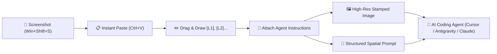

<p align="center">
  
</p>

<h1 align="center">⚡ VibeAnnotator</h1>
<p align="center">
  <strong>The Visual Agent Prompting Studio for Vibe-Coding with AI Agents</strong><br>
  <em>Paste screenshots, draw precision bounding boxes labeled <code>[L1]</code>, <code>[L2]</code>, and export stamped high-res images + spatial agent prompts in 1-click.</em>
</p>

<p align="center">
  <a href="https://github.com/IrMaho/vibe-annotator/blob/main/LICENSE"></a>
  <a href="https://flutter.dev"></a>
  <a href="https://dart.dev"></a>
  
  
</p>

---

## 🎯 The Vibe-Coding Problem & Solution

When building apps with AI coding agents (like **Antigravity**, **Cursor**, **Claude 3.7 Sonnet**, **Gemini 2.0**, or **Windsurf**), explaining visual changes and UI bug fixes via pure text is slow, ambiguous, and frustrating.

**VibeAnnotator** turns this into a 10-second superpower:
1. **Snip:** Take any screenshot (`Win + Shift + S` or `PrintScreen`).
2. **Paste:** Hit `Ctrl + V` inside VibeAnnotator to paste directly from your clipboard.
3. **Tag:** Drag bounding boxes over UI elements. Each area is automatically stamped with neon badges like `[L1]`, `[L2]`, `[L43]`.
4. **Instruct:** Type your instructions or feedback for each tagged area.
5. **Ship to Agent:**
   - **Output 1:** Export a native-resolution screenshot with crisp markers burned in (ready to paste with `Ctrl + V` into your AI chat).
   - **Output 2:** 1-click copy a structured spatial prompt mapping each `[L#]` tag directly to pixel bounds, normalized vision coordinates `[ymin, xmin, ymax, xmax]`, general quadrant hints, and exact requirements.

---

## 🏎️ Workflow Diagram



---

## ✨ Features

- 📋 **Zero-Friction Clipboard Paste (`Ctrl + V`)**: Direct clipboard image memory parsing without saving junk files to disk.
- 🗂️ **Multi-Screenshot Workspace**: Manage multiple open screens in a clean tabbed strip.
- 🏷️ **Smart Spatial Tagging (`[L1]`, `[L2]`, ...)**: Auto-incrementing markers with high-contrast luminance calculation for badges.
- 📐 **Pixel-Perfect 1:1 Coordinate Mapping**:
  - Unconstrained interactive canvas with native pixel coordinates.
  - Automatic initial viewport fit (`Fit to Screen`).
  - Pan & Zoom support with smooth matrix transformations.
  - Hold `Space` to pan at any time.
- 🏎️ **Sport Racing Design System**:
  - Crisp Ice-White background (`#F6F8FC`).
  - Racing Crimson Red primary accents (`#E11D48`).
  - Carbon Black telemetry & console aesthetics (`#0F172A`).
  - Soft fading gradients and glowing drop shadows.
- ⚡ **4 AI Prompt Formats**:
  1. **Standard Vibe-Coding**: Comprehensive Markdown guide with pixel bounds, spatial positions, and bulleted requests.
  2. **Compact Spatial Vision**: Token-efficient format optimized for multimodal vision models (Gemini 2.0 / Claude).
  3. **Task Checklist**: Step-by-step checklist formatted for agents to systematically execute and check off.
  4. **JSON Payload**: Raw structured data for automated CLI pipes and agent API integrations.

---

## 📋 Sample Agent Prompt Output

```markdown
# 🎨 Visual Feedback & Modification Guide for AI Agent
**Target Image:** "Dashboard_Screenshot.png" (1584 × 892 px)
**Screen Goal:** Refactor this dashboard into Flutter with Clean Architecture and a Sport Red theme.

Please inspect the attached image with annotated bounding boxes tagged with IDs like `[L1]`, `[L2]`, etc.
Below is the exact coordinate mapping and requirements for each labeled section:

### 🏷️ Marker `[L1]` : Logo & Header
- **General Position:** Top-Left
- **Pixel Coordinates:** x: 38, y: 16, width: 280, height: 60
- **Normalized BBox (0-1000):** `[ymin: 17, xmin: 24, ymax: 85, xmax: 200]`
- **Category:** UI/UX Design
- **Priority:** High
- **Requested Change / Comment:**
  > Redesign logo with a sport crimson red glow and add a badge saying "SPORT" next to it.

### 🏷️ Marker `[L2]` : Metric KPI Card
- **General Position:** Center-Right
- **Pixel Coordinates:** x: 860, y: 120, width: 340, height: 180
- **Normalized BBox (0-1000):** `[ymin: 134, xmin: 542, ymax: 336, xmax: 757]`
- **Category:** New Feature
- **Priority:** Critical 🔥
- **Requested Change / Comment:**
  > Add an animated counter and an interactive sparkline curve with gradient glow on hover.

---
**Instructions for Agent:**
1. Cross-reference each marker tag `[L#]` against the visually stamped labels in the screenshot.
2. Apply the requested changes with high fidelity, maintaining clean code architecture and responsive layout.
3. Confirm completion of each marker tag when reporting back.
```

---

## ⌨️ Keyboard Shortcuts

| Shortcut | Action |
| :--- | :--- |
| **`Ctrl + V`** | Paste screenshot directly from OS clipboard |
| **`Ctrl + C`** | Instant copy generated agent prompt |
| **`Space` (Hold)** | Pan across the canvas freely |
| **`R`** | Box drawing tool (Rectangle) |
| **`V`** | Select, move, and inspect tool |
| **`H`** | Dedicated pan & zoom tool |
| **`Delete` / `Backspace`** | Delete selected bounding box |
| **`Esc`** | Deselect active annotation |

---

## 🚀 Getting Started

### Prerequisites
- [Flutter SDK](https://docs.flutter.dev/get-started/install) (3.38+ recommended)
- Dart 3.10+
- Desktop development tools enabled (`flutter config --enable-windows-desktop` or macOS/Linux)

### Installation

```bash
# Clone the repository
git clone https://github.com/IrMaho/vibe-annotator.git
cd vibe-annotator

# Install dependencies
flutter pub get

# Run on your desktop
flutter run -d windows
```

### Build Executable
```bash
flutter build windows --release
```
The binary will be located at `build/windows/x64/runner/Release/vibe_annotator.exe`.

---

## 🏗️ Architecture

```
lib/
├── main.dart                      # App entry point, keyboard bindings, sport theme setup
├── models/
│   ├── annotation_region.dart     # Bounding box model, pixel/normalized conversion, spatial heuristics
│   ├── image_item.dart            # Image session, decoded metadata, annotations container
│   └── prompt_template.dart       # Prompt format configurations
├── services/
│   ├── clipboard_service.dart     # Fast OS clipboard image & text read/write
│   ├── image_renderer_service.dart# Native high-res canvas rendering & badge burning
│   └── prompt_generator_service.dart # Multi-format prompt synthesis engine
├── state/
│   └── app_state.dart             # Reactive state management with ChangeNotifier
├── utils/
│   ├── color_palette.dart         # High-contrast label colors & luminance calculation
│   └── theme.dart                 # Sport design tokens, crimson gradients & shadows
└── widgets/
    ├── canvas/
    │   ├── annotation_canvas.dart # Unconstrained InteractiveViewer & coordinate mapping
    │   ├── annotation_painter.dart# Adaptive high-res box & badge rendering
    │   └── canvas_toolbar.dart    # Floating telemetry HUD toolbar
    ├── dialogs/
    │   └── quick_help_dialog.dart # Interactive workflow & shortcut modal
    ├── inspector/
    │   ├── annotation_card.dart   # Region editing card (title, comment, category, priority)
    │   ├── prompt_preview_view.dart # Live agent prompt preview & 1-click export
    │   └── regions_inspector_view.dart # List view & global screen objective
    ├── tabs/
    │   └── image_tab_strip.dart   # Multi-screenshot session tabs
    └── top_nav_bar.dart           # Sport header with quick paste & status indicators
```

---

## 🤝 Contributing

Contributions, feature ideas, and pull requests are warmly welcomed!
1. Fork the Project
2. Create your Feature Branch (`git checkout -b feature/AmazingFeature`)
3. Commit your Changes (`git commit -m 'Add some AmazingFeature'`)
4. Push to the Branch (`git push origin feature/AmazingFeature`)
5. Open a Pull Request

---

## 📄 License

Distributed under the **MIT License**. See [`LICENSE`](LICENSE) for more information.

<p align="center">
  Crafted with ❤️ for developers who love <strong>Vibe-Coding</strong>.
</p>
